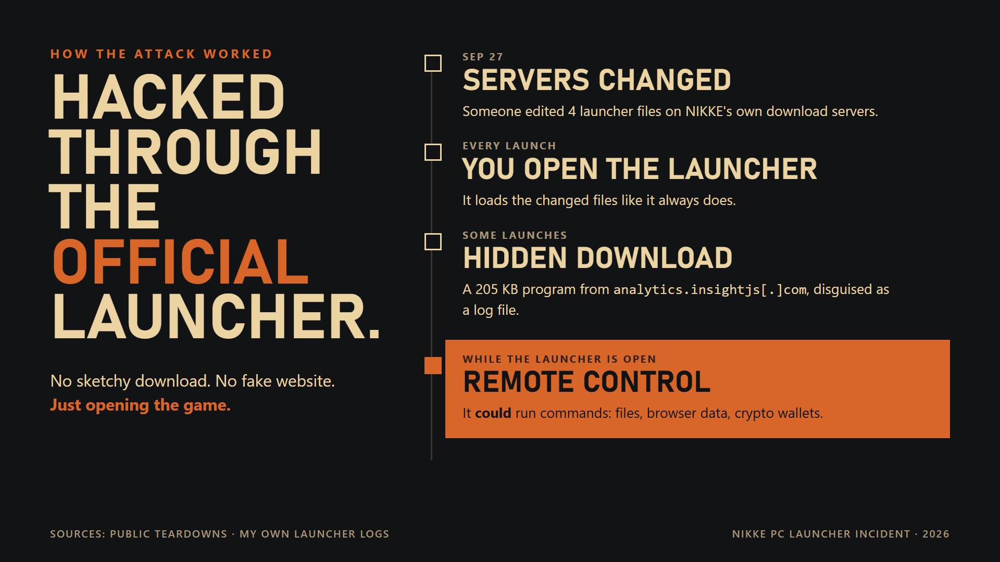

# The NIKKE PC launcher incident: full breakdown from my point of view

I'm Necromancer (necromancer124), an IT student. In late October and early November 2026 the official PC launcher of *GODDESS OF VICTORY: NIKKE* ran attacker code on two of my PCs. This repo is my complete write-up: what happened to me, what my logs show, how my friend Springz and I traced the attacker's server, how it was reported and taken down, and what I can and cannot prove.

It is the serious companion to my story video **[*"How I Once Defended Gooners From a Cyber Attack"*](https://youtu.be/a494T6VFqEA)** (YouTube).

> **Status: private draft.** Read [`BEFORE-PUBLISHING.md`](BEFORE-PUBLISHING.md) before making this repo public.

> 🛡️ **Safety:** the attacker's domain and IP are written **defanged** everywhere (`analytics.insightjs[.]com`, `89.127.233[.]127`). Do not visit them.

## The short version

- On **September 27, 2026**, someone took over a domain the game had used, and five hours later four files on NIKKE's own download servers were changed to load code from it. From then on the official PC launcher could quietly download a small program and run it while the launcher was open. No fake website, no sketchy download: just opening the game.
- **My desktop** ran it once, on **October 31**. **My laptop** ran it three times, on **November 1, 2 and 3**, each time I opened the launcher for my daily login.
- My friend Springz warned me on **November 3 at 19:03**. My laptop's last infection was two hours earlier.
- On **November 4** I confirmed it from my own logs, then followed the domain in those logs to an IP address and to the company renting out the server: **1984 ehf** in Iceland.
- Springz sent the abuse reports. The host confirmed the server was shut down. The domain registrar suspended the domain on **November 5**, about five hours after his report.
- **I cannot prove anything was stolen, and I cannot prove nothing was.** I treated everything as exposed.
- As of **November 13, 2026**, as far as I know, the attacker has not been caught. If you were affected, report it to your local police or cybercrime authority.

## What's in here

| File | What it covers |
|---|---|
| [`docs/01-timeline.md`](docs/01-timeline.md) | Everything in order, with times: my PCs, our chat, the reports, the official notices |
| [`docs/02-how-the-attack-worked.md`](docs/02-how-the-attack-worked.md) | The attack chain in plain words, and which parts I saw myself |
| [`docs/03-my-laptop.md`](docs/03-my-laptop.md) | Laptop: three infections, what the logs show, the cleanup |
| [`docs/04-my-desktop.md`](docs/04-my-desktop.md) | Desktop: one earlier infection, with the original logs preserved |
| [`docs/05-tracing-the-server.md`](docs/05-tracing-the-server.md) | Domain → IP → hosting company → registrar, using public records only |
| [`docs/06-reports-and-takedown.md`](docs/06-reports-and-takedown.md) | The abuse reports, the two replies from the host, the domain suspension, and who deserves credit |
| [`docs/07-what-i-can-prove.md`](docs/07-what-i-can-prove.md) | Proven / not proven / limits of my evidence |
| [`docs/08-cleanup-and-recovery.md`](docs/08-cleanup-and-recovery.md) | What I removed, blocked and changed, and what I'd do differently |
| [`docs/09-indicators.md`](docs/09-indicators.md) | Indicators of compromise (defanged) and where to look on your own PC |
| [`docs/10-if-you-were-affected.md`](docs/10-if-you-were-affected.md) | A short checklist for other players |
| [`docs/11-credits-and-sources.md`](docs/11-credits-and-sources.md) | The people who actually figured this out, and every source I used |
| [`evidence/`](evidence/) | Redacted log excerpts, public screenshots, the registry record |
| [`tools/`](tools/) | The two PowerShell scripts I used on my desktop (cleanup + evidence viewer) |

## How to read this

- **"I saw this myself"** means it is in my own logs or on my own screen.
- **"Reported by others"** means it comes from the community analyses listed in [`docs/11-credits-and-sources.md`](docs/11-credits-and-sources.md). I did not reverse-engineer the malware and I never saved a sample of it.
- Times are **my local time (GMT+2)** unless marked GMT.
- "We" means Springz and me. He wrote and sent the reports; I did the log checking and the tracing.

## What this repo is not

- Not an official statement from SHIFT UP or Level Infinite, and not affiliated with them.
- Not a malware analysis. For that, read MotherSphere's and whyKusanagi's work (linked in the credits).
- Not legal advice.

My raw evidence (full logs, Windows event logs, hashes) stays offline on my PCs. Only redacted excerpts are here. My other tool for sharing logs safely is [`nikke-log-redactor`](https://github.com/necromancer124/nikke-log-redactor).
