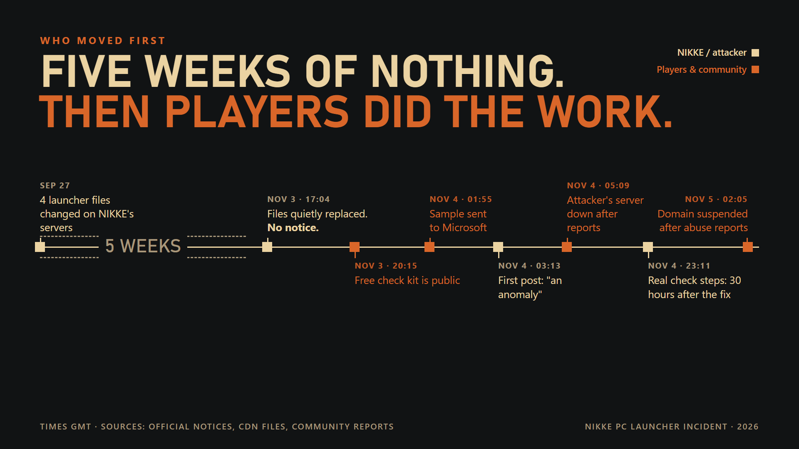

# 1. Timeline

Times are **my local time (GMT+2)** unless a line says GMT. "Source" tells you whether I saw it myself.

## Before I knew anything

| When | What happened | Source |
|---|---|---|
| **Sep 27** | Four launcher files are changed on NIKKE's own download servers. The attacker's domain `insightjs[.]com` is registered the same day. | Community analysis; registration date from the public registry record ([`evidence/insightjs-rdap-verisign-nov12.json`](../evidence/insightjs-rdap-verisign-nov12.json)) |
| Sep 27 → Nov 3 | About five weeks in which the changed files sit on the servers. | Community analysis, official notice |
| **Oct 31, 19:15** | **My desktop** opens the launcher. It downloads the payload and the agent starts, all within one second. I close the launcher around 19:41 and never open it on that PC again. | My desktop logs |
| **Nov 1, 20:38** | **My laptop**, infection 1. | My laptop logs |
| **Nov 2, 22:19** | My laptop, infection 2. | My laptop logs |
| **Nov 3, 17:03** | My laptop, infection 3 (the last one). | My laptop logs |
| Nov 3, 17:04 GMT | NIKKE quietly replaces the changed files. No notice yet. | Community timeline |
| **Nov 3, 19:03** | Springz messages me: *"don't launch nikke … our laptops got infected with some dll virus"*. Two hours after my last infection. I don't read it until the next morning. | Our Discord chat |
| Nov 3, 20:15 GMT | A free community check kit is already public. | Community timeline |

## November 4: finding out, and tracing

| When | What happened | Source |
|---|---|---|
| Nov 4, 03:13 GMT | First official post. It calls the incident an "anomaly". | Official notice, community timeline |
| 11:03–11:10 | Springz is annoyed, not scared: people online are arguing about whether it is even real. He asks if I deleted the launcher yet. I had not. | Our chat |
| 11:16–11:22 | I read the code of a community scanner before running it. Running an unknown "virus checker" in the middle of an attack is how you get hacked twice. | Me |
| **11:23** | I run it. Verdict: **INFECTED**. My logs show the downloads and the agent starting. | My laptop |
| 11:30–11:41 | Springz wonders if it is just an anti-cheat or an event tool. I disagree, loudly. | Our chat |
| Nov 4 (day) | I clean the laptop: uninstall the launcher and its leftovers, keep redacted copies of the logs. | Me |
| **22:18** | I look up the IP address my logs point to. It belongs to **1984 ehf**, a hosting company in Reykjavik, Iceland. A rented server, not a VPN. | Public records |
| 22:23 | I find another infected player's public scan result showing the same IP address. Same domain, same server. | Public post |
| 22:36 | Springz posts the result publicly and asks people not to harass the host: *a host isn't the attacker*. | His public post |
| ~23:00 | Springz reports the server and the domain to the host. **Two replies arrive in the same minute**: the abuse department says the domain only uses their free DNS and to ask the registrar; the security team says the server has been shut down. | The host's emails (public in his post) |
| 23:11 GMT | The official step-by-step check instructions are published, about 30 hours after the files were replaced. | Official notice |
| 23:33 | Springz sends a follow-up asking the host to **keep its logs for the publisher or law enforcement**. | Our chat |
| 23:34 | We check the registry record: the registrar is **PublicDomainRegistry (PDR)**. Springz reports the domain there. | Public records |

## November 5: the domain goes down

| When | What happened | Source |
|---|---|---|
| **Nov 5, 02:05 GMT** | The registry record changes: the domain is put on **client hold** (suspended). | Public registry record |
| 10:46–11:54 | Me: "did they answer you?" Springz: "No. Silence everywhere." He had just flown to America; it was 5 AM for him. | Our chat |
| **12:24** | Springz forwards the registrar's email: they *"have suspended the reported domain name"*. About five hours after his report. | The registrar's email |
| 12:44 | Springz posts that the attacker's domain is down. | His public post |
| 14:30 | Springz announces "phase 2": loss reporting and an evidence package for the publisher, regulators and police. | His public post |

## Afterwards

| When | What happened | Source |
|---|---|---|
| Nov 5 | I verify the hashes of my laptop evidence folder. | Me |
| **Nov 6** | I remember my desktop, check it, and find the October 31 infection. This time I copy the logs **before** cleaning anything. | My desktop |
| Nov 12 | The public registry record still shows the domain on client hold. | [`evidence/images/insightjs-client-hold-rdap-nov12.png`](../evidence/images/insightjs-client-hold-rdap-nov12.png) |
| Nov 13 | As far as I know, the attacker has not been identified or caught. | - |

## The official side, on one line

Two things I am careful about:

- I say the files **sat on the servers** for five weeks. I do not claim anyone at NIKKE *knew* for five weeks.
- "Days of silence" would be wrong. The first official post came about **10 hours** after the files were replaced, and the real instructions about **30 hours** after.
