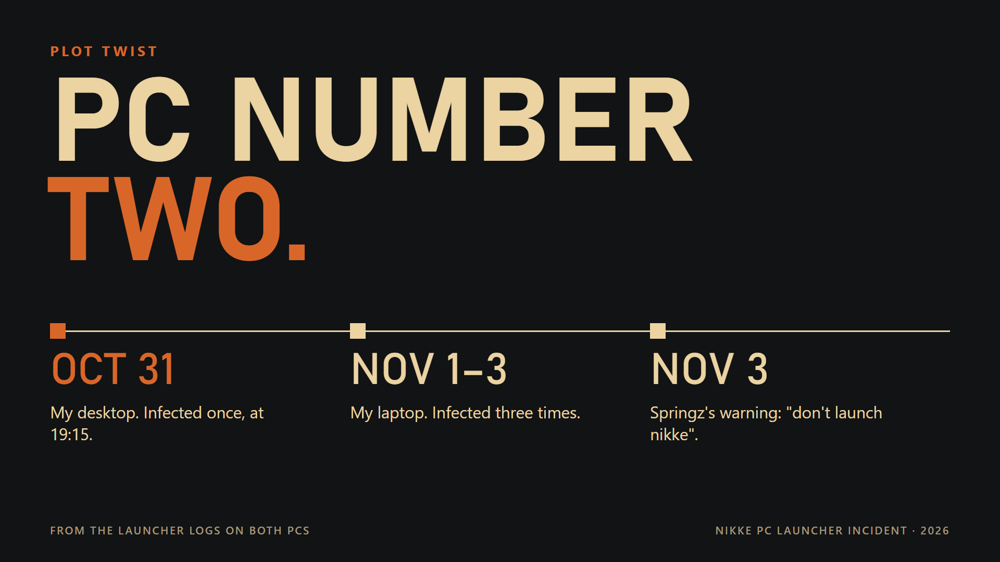

# 4. My desktop: the one I forgot about

I cleaned my laptop, felt clever, and then remembered I had also installed NIKKE on my desktop.



## What happened

**One** infection: **October 31, 19:15**. That is earlier than any infection on the laptop, and three days before Springz's warning.

I closed the launcher around 19:41 that evening and never opened it on the desktop again.

## What the logs show

This time I copied the logs **before** cleaning anything, so the originals are intact (kept offline, with a SHA-256 manifest verified on November 6).

**The launcher's `debug.log`** (PC name removed):

```
[1031/191508.367:INFO:CONSOLE(1)] "lua downloaded to log\tinyget\tinyget.20261031-191507-353.log"
[1031/191508.542:INFO:CONSOLE(1)] "k2f_chan registered"
[1031/191508.924:INFO:CONSOLE(1)] "agent started as [PC NAME REMOVED]"
```

**The downloader's log** (shortened, address defanged):

```
[2026-10-31 19:15:07.367] TinyDownloader::AddTask   url=hxxps://analytics.insightjs[.]com/comm/assets/insight.bundle
[2026-10-31 19:15:07.706] [CURL] Connected to analytics.insightjs[.]com (89.127.233[.]127) port 443
[2026-10-31 19:15:08.351] HttpCurl::Download        curl perform success.
[2026-10-31 19:15:08.351] DownloadTask::OnDownloadResult   result=0, error_code=0, total=205135
```

That second line is the most useful single line I have: it ties the **domain** to the **IP address** at the moment of infection, from my own PC. The domain no longer resolves, so nobody can repeat that lookup today.

**Also found:**

- The agent's saved state in the launcher's browser storage: 4 messages sent, a check-in interval of 1,800 seconds, and cookie collection switched **off** in that saved state.
- The launcher's code cache held two of the four changed loader entries, both written at 19:15:07.
- The payload file itself was gone (it deletes itself after starting). The download record survived.

## What was *not* there

- No HKCU CLSID registry change, no dropped DLL, no leftover files in the temp folder.
- No new scheduled tasks, Run keys or WMI persistence.
- No Windows "log cleared" events. The System log goes back to May.

## Being honest about this PC

When I checked the desktop properly, I found it had **other, unrelated malware** on it too: an older infection from a game installer that did not come from an official store, and a separate PowerShell trojan that Microsoft Defender had blocked in October. Neither has anything to do with NIKKE.

That matters for one reason: **I cannot pin any loss on this PC on the NIKKE incident**, because NIKKE was not the only thing wrong with it. I treated everything on it as exposed.

So, to keep the two PCs straight:

| | Laptop | Desktop |
|---|---|---|
| NIKKE infections | 3 (Nov 1, 2, 3) | 1 (Oct 31) |
| Original logs kept | No (redacted copies only) | **Yes** |
| "Defender detected nothing" | True | Not a fair claim: Defender caught *other* malware here |
| Other malware present | None found | Yes, unrelated |

## What I did (November 6)

1. Copied the launcher logs, the launcher's browser storage and the relevant Windows event logs to an evidence folder, with hashes.
2. Blocked the attacker's domains in the hosts file and the attacker's IP addresses in the firewall.
3. Deleted the launcher's cache (a copy is in the evidence).
4. Checked that the domain no longer resolves from this PC.

The script that did this is in [`tools/nikke-cleanup.ps1`](../tools/nikke-cleanup.ps1).
