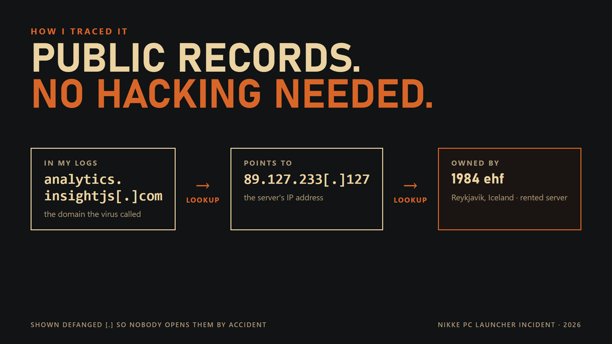

# 5. Tracing the server

No hacking was needed, and none was done. Everything here comes from my own logs and from public records anyone can look up.

## Step 1: the domain was in my logs

Every infection in my launcher logs pointed at the same address: `analytics.insightjs[.]com`. The name is built to look like a boring analytics service.

## Step 2: domain → IP address

Two independent things gave me the IP address `89.127.233[.]127`:

1. **My own log.** The launcher's downloader wrote `Connected to analytics.insightjs[.]com (89.127.233[.]127) port 443` at the moment of infection (see [`04-my-desktop.md`](04-my-desktop.md)).
2. **Another player's public scan result.** Their scanner output listed the same address as the server it had checked. Same malware, same server.

A second address in the same hosting range, `89.126.250[.]172`, was also listed in community indicator lists. I blocked both, but only the first one appears in my own logs.

## Step 3: IP address → company

Every IP address belongs to a block, and the block's owner is public (WHOIS / RDAP). The lookup said:

- **Owner:** 1984 ehf, Reykjavik, Iceland
- **Network:** AS44925

1984 is a hosting company. So the attacker was not hiding behind a VPN, and was not some genius with their own data centre. They had **rented a server**.

A hosting company is not the attacker. It is the one party that can switch the server off and that holds the customer and payment records investigators would need. That is why the report went there, politely.

## Step 4: domain → registrar

Killing the server is not enough. The attacker can rent another one and point the same domain at it. To stop that, the **name itself** has to be suspended, and only the registrar can do that.

The public registry record (RDAP) for `insightjs[.]com` shows:

- **Registrar:** PDR Ltd. (PublicDomainRegistry)
- **Name servers:** 1984's free DNS service
- **Registered:** September 27, 2026: the same day NIKKE says the attack began

The raw record is in [`evidence/insightjs-rdap-verisign-nov12.json`](../evidence/insightjs-rdap-verisign-nov12.json).

## What this does and does not tell us

- It tells us **where the server was rented** and **who sold the domain name**.
- It does **not** tell us who the attacker is. Only the host's and registrar's private records could, and those are for the police, not for us.

That is why the reports asked the host to **keep its logs** for the publisher or law enforcement.

## Tools I used

All free and public:

- The launcher's own log files
- An IP WHOIS lookup site
- An RDAP lookup (the registry's own record for the domain)
- A text editor

I did not scan, probe or connect to the attacker's server at any point.
