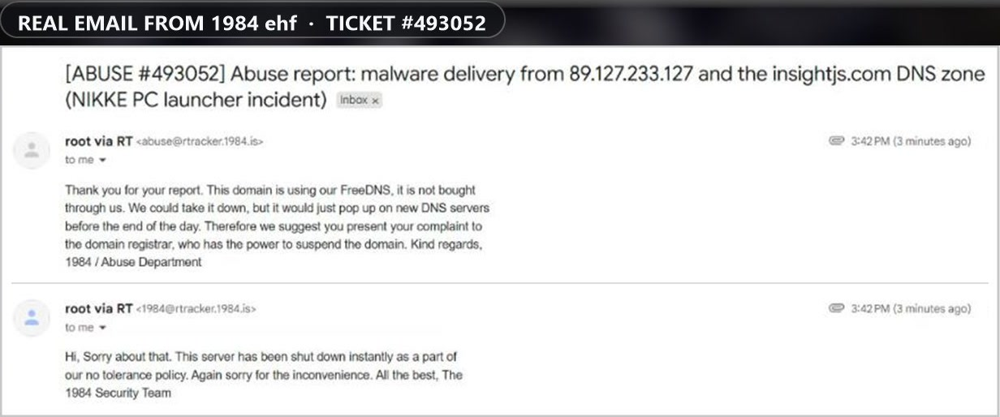
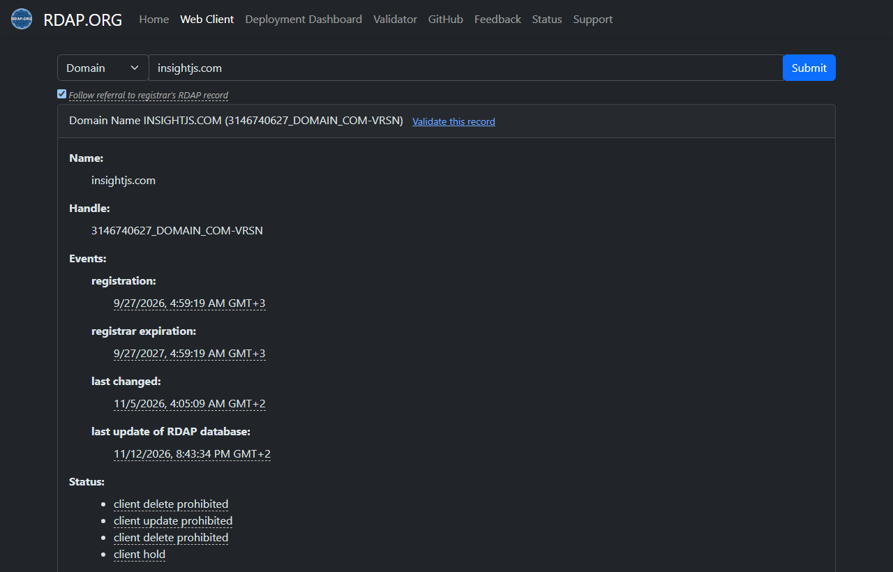
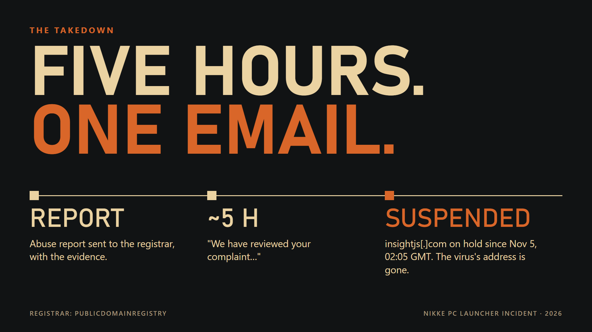
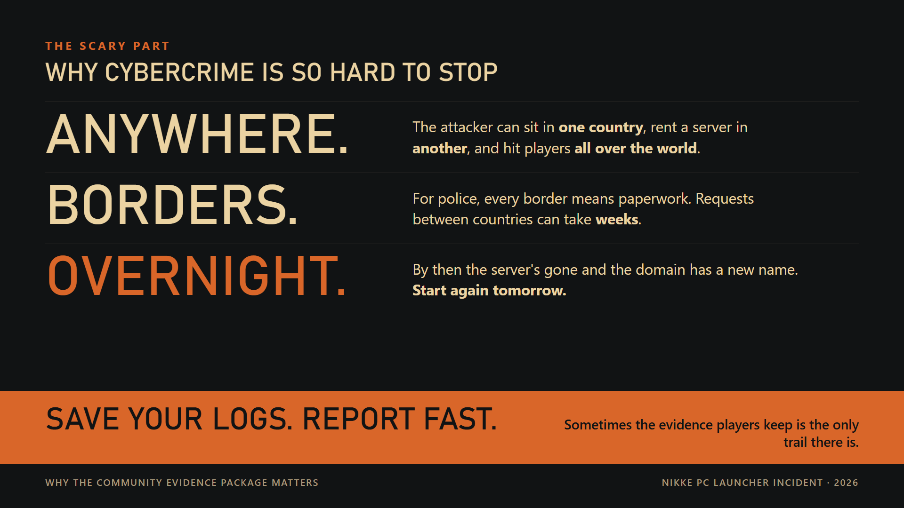

# 6. The reports and the takedown

I'm a student. I can't arrest anyone. But hosting companies and registrars have abuse teams, and they do not want malware on their services.

Springz wrote and sent the reports. I supplied the log evidence and the trace.

## What a good abuse report contains

No angry capitals. Just:

1. **What it is:** malware delivered from this server, as part of the NIKKE PC launcher incident.
2. **Where:** the IP address and the domain.
3. **Proof:** log lines showing the download from that address, and links to the public analyses.
4. **The ask:** take it down, and **keep the logs** for the publisher or law enforcement.

## The host: two replies in one minute

Springz reported the server and the domain to 1984. Two replies arrived in the same minute, from two different departments:

1. **Abuse department:** the domain only uses their free DNS service and was not bought through them; they could remove it but it would reappear on other DNS servers, so the complaint should go to the registrar, who can suspend the domain.
2. **Security team:** *"This server has been shut down instantly as a part of our no tolerance policy."*

Both are correct, which is what makes it funny. The first is about the **name**, the second about the **server**.

Springz then sent a follow-up asking which server had been shut down, whether related addresses existed, and for the logs to be preserved.

*(These emails are already public in Springz's post, including the ticket number.)*

## The registrar: the domain itself

With the server down, the domain still existed and could be pointed at a new server. So Springz reported it to the registrar, PublicDomainRegistry.

About five hours later the registrar replied that they had reviewed the complaint and **suspended the reported domain name**. The public registry record shows the change:

- Status: **client hold**
- Last changed: **November 5, 2026, 02:05 GMT**
- Still on hold when I checked on November 12

With the domain on hold, the address the malware called no longer leads anywhere. For anyone who had not opened the launcher yet, the old attack had nowhere left to send anything.

## Who gets the credit: read this part

In [my video](https://youtu.be/a494T6VFqEA) I say "we shut it down". That is the story from where I was standing: the confirmations and the domain suspension email arrived in our chat. The precise version is:

- **The server.** According to whyKusanagi's timeline, the host shut the server down on **November 4 at 05:09 GMT**, after an abuse report from another researcher. One community report even says it stopped answering on November 3, 18:31 GMT (unconfirmed). Springz's report came later the same day, and the host's security team **confirmed** the shutdown to him. So the server was not taken down by our report. What I can say is: *the host confirmed to us that the server was shut down.*
- **The domain.** Several people reported the domain to the registrar. Springz has the registrar's email confirming that **his** report was reviewed and the domain was suspended about five hours later. *"We alone took it down"* would not be accurate. *"Our report was reviewed and the domain was suspended"* is.

Everyone who reported the server and the domain shares this. They are listed in [`11-credits-and-sources.md`](11-credits-and-sources.md).

## Why reporting fast matters

The attacker can sit in one country, rent a server in a second and hit players in a hundred more. For police, every border is paperwork, and requests between countries can take weeks. By then the server is gone and the domain has a new name.

Logs kept by victims, and records kept by hosts and registrars because someone asked in time, are sometimes the only trail there is.

## What we did not do

- We did not attack, scan or log in to the attacker's server.
- We did not publish anyone's name as "the hacker". Nobody has been publicly identified.
- We asked people not to harass the host or the registrar. They are not the attacker, and they acted quickly.
