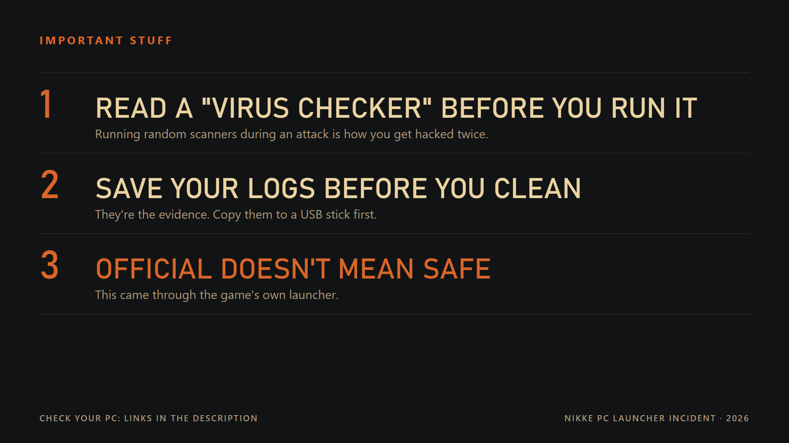

# 8. Cleanup and recovery

What I actually did, in the order I'd recommend. This is my own experience, not official guidance: follow the publisher's instructions first (linked in [`10-if-you-were-affected.md`](10-if-you-were-affected.md)).

## 1. Evidence first

On the laptop I cleaned first and regretted it. On the desktop I did it properly:

- Copied the whole launcher folder (`log\`, `intl_service\`), and the launcher's browser storage.
- Exported the relevant Windows event logs (Security, System, PowerShell, Defender).
- Recorded SHA-256 hashes of every file, so I can show later that nothing was altered.
- Checked for signs of log tampering (events 1102 and 104, gaps in the logs). Found none.
- Kept a zipped copy offline.

**Why:** the official scan and most cleanup tools delete what they find. Once the logs are gone, so is your proof for the publisher, the police, or your bank.

## 2. Remove

- Closed the launcher and its background service.
- Uninstalled the launcher; deleted its leftover folders and cache.
- Checked for the reported persistence: the HKCU CLSID registry entry, the dropped DLL, leftover `k2f` files in the temp folder, new scheduled tasks and Run keys. None were present on my PCs.

## 3. Block

So that an old copy of the launcher could never reach the attacker again:

- Added the attacker's domains to the Windows **hosts** file, pointing nowhere.
- Added **firewall rules** blocking the attacker's IP addresses in both directions.
- Confirmed the domain no longer resolves from the PC.

The exact list is in [`09-indicators.md`](09-indicators.md). The script is [`tools/nikke-cleanup.ps1`](../tools/nikke-cleanup.ps1); read it before you run it.

## 4. Scan

- Full Microsoft Defender scan, then a Defender Offline scan.
- On the desktop this is also how I found the unrelated older malware, which had switched off Defender's scanning for part of the disk. I removed those exclusions and scanned again.

A clean scan is not proof of anything here: Defender never flagged the NIKKE agent on my laptop.

## 5. Recover the accounts

All from a **different, clean device**:

- Changed passwords, starting with email, then anything with money, then the rest.
- Logged out of all sessions everywhere. A stolen login cookie keeps working after a password change unless the sessions are ended.
- Turned on two-factor authentication everywhere it exists.
- Replaced SSH keys and API tokens that lived on those PCs.
- Checked account login histories for places and devices I didn't recognise.

## 6. What I'd still recommend

For a PC that ran attacker code, the only way to be *sure* is to **reinstall Windows**. Everything above reduces the risk; a reinstall removes the doubt. On my desktop, with two other infections on it, that is the right answer.

## What I'd do differently

| I did | Better |
|---|---|
| Cleaned the laptop before copying the logs | Copy first, always |
| Kept the launcher installed on a PC I'd stopped using | Uninstall what you don't use |
| Had no logging beyond Windows defaults | Sysmon and file auditing would have answered "what did it touch?" |
| Trusted "it's official" | Official doesn't mean safe. It means *usually* safe |

